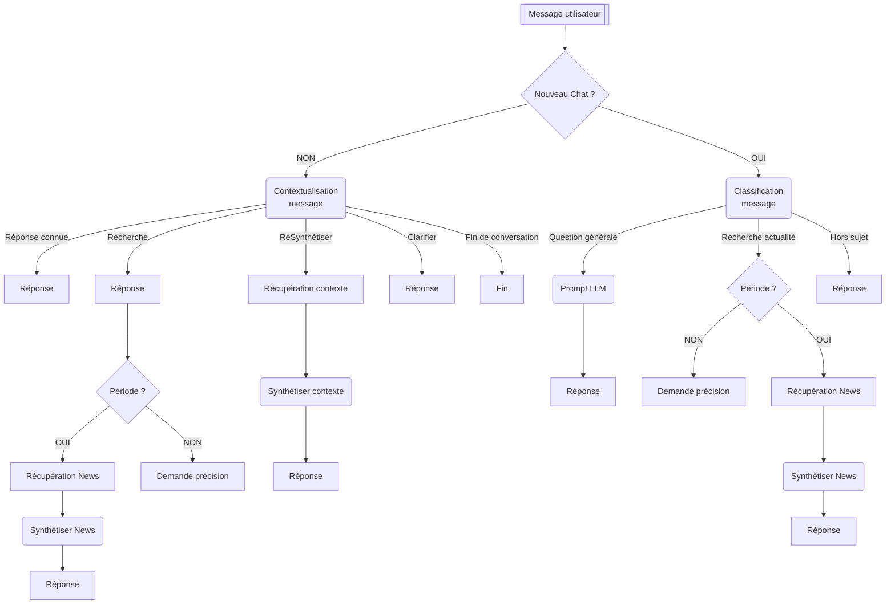

# frontend

https://ocr-news-foundry-9c5v0ehgn-ace4tea-m.vercel.app/


# backend

https://ocr-newsfoundry.onrender.com/

## Liste des tests unitaires
- Un utilisateur valide reçoit un cookie JWT HttpOnly
- Un email incorrect ne permet pas de se connecter
- Un mot de passe incorrect ne permet pas de se connecter


## Executer les tests unitaires:
```bash
uv run --env-file .env pytest -v
```

## Logique d'exécution du chat
Fonctionnement du chat et enchaînement des différentes étapes nécessaires au traitement d'un message utilisateur. Décrit le rôle des agents IA, les décisions prises en fonction de la demande, ainsi que l'orchestration des traitements par le backend, depuis la réception du message jusqu'à la génération de la réponse.



## Revues de presses

Chaque utilisateur dispose de son historique de revues de presses générées à partir des différents chat de discutions
L'utilisateur à la possibilité ensuite de visualiser l'ensemble des revues de presses dans une vue dédiée