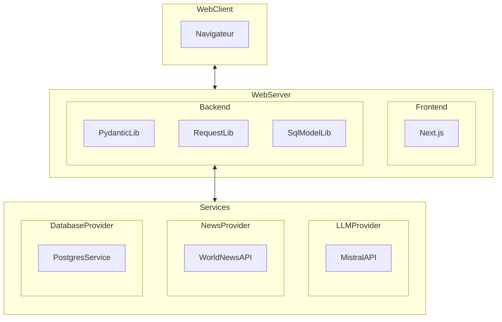
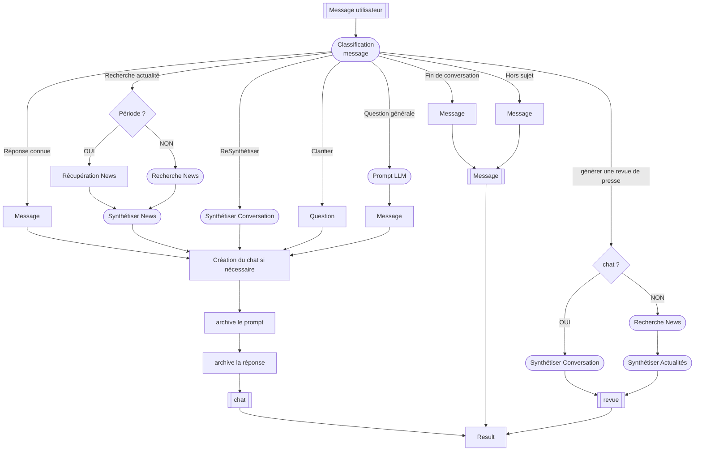

# NewsFoundry - Développement

[](https://github.com/Ace4teaM/OCR-NewsFoundry/actions/workflows/python-tests.yml)

**Synthétise les choix de conceptions et les outils nécessaires au développement du projet.**

Ce document est écrit et modifié par l'équipe de **développement informatique**.
> merci de mettre à jour ce document en cas de modifications du projet.

# Architecture

**NewsFoundry** est réalisé sur une architecture **FullStack Web**.

Ce graphique représente les dépendances entre les différents composants de l'architecture logicielle:



## Prérequis

- Docker
- Python 3.13
- uv
- Node.js 22.19

## Arborescence

Décrit l'arborescence du projet.

**frontend**

|                | description                                                  |
| -------------- | ------------------------------------------------------------ |
| src/app        | Contient les pages de l'application, les layouts et les éléments liés au routage Next.js (App Router). |
| src/components | Regroupe les composants React réutilisables qui constituent l'interface utilisateur. |
| src/config     | Centralise les paramètres et constantes de configuration de l'application : URLs d'API, variables d'environnement, paramètres globaux, etc. |
| src/contexts   | Contient les contextes React permettant de partager des états et des données entre plusieurs composants sans avoir à transmettre systématiquement des propriétés. |
| src/hooks      | Regroupe les hooks React personnalisés qui encapsulent des traitements réutilisables liés aux composants, aux états ou aux interactions avec l'application. |
| src/utils      | Contient les fonctions utilitaires indépendantes de l'interface : formatage, transformations de données, validation, gestion des réponses API, etc. |

**backend**

| emplacement               | description                                                  |
| ------------------------- | ------------------------------------------------------------ |
| src/ai.py                 | Implémentation du client LLM                                 |
| src/ai-[mistral].py       | Implémentation alternative du client LLM (Mistral)           |
| src/ai_classify_agent.py  | Implémentation de l'agent de classification                  |
| src/ai_research_agent.py  | Implémentation de l'agent de recherche d'actualités          |
| src/ai_revues_agent.py    | Implémentation de l'agent de synthétisation de conversation basé sur un thème |
| src/ai_synthesis_agent.py | Implémentation de l'agent de synthétisation d'articles basé sur un prompt |
| src/database.py           | Implémentation l'initialisation de la base de données        |
| src/errors.py             | Implémentation centralisé de la gestion des erreurs          |
| src/logger.py             | Implémentation centralisé des journaux                       |
| src/main.py               | Implémentation du serveur et des routes FastAPI              |
| src/models.py             | Implémentation du model de données métier                    |
| src/rate_limiter.py       | Outil de limitation de requêtes utilisé par le client Http du LLM |
| src/result.py             | Définition du format d'erreur                                |
| src/worldnews.py          | Implémentation du client WorldNews API                       |
| src/tests/                | Tests unitaires                                              |

## Variables d'environnement

**Frontend**

| Variable              | Description                                                  |
| --------------------- | ------------------------------------------------------------ |
| `NEXT_PUBLIC_API_URL` | URL de l'API accessible depuis le navigateur. Le préfixe `NEXT_PUBLIC_` permet d'exposer cette variable au code JavaScript côté client Next.js. |
| `API_URL`             | URL de l'API utilisée côté serveur Next.js. Cette variable reste privée et n'est pas exposée au navigateur. |

**Backend**

| Variable                          | Description                                                  |
| --------------------------------- | ------------------------------------------------------------ |
| `ALLOW_ORIGINS`                   | Liste des origines autorisées à accéder à l'API via CORS. (séparé par des barres verticales `|` ).<br />**Exemple:** `https://ocr-newsfoundry.onrender.com|https://ocr-news-foundry.vercel.app` |
| `DATABASE_URL`                    | URL de connexion à la base de données PostgreSQL.            |
| `JWT_SECRET_KEY`                  | Clé secrète utilisée pour signer et vérifier les jetons JWT d'authentification. |
| `JWT_ACCESS_TOKEN_EXPIRE_MINUTES` | Optionnel. Temps avant expiration du Token de session (30 par défaut) |
| `COOKIE_SECURE`                   | Active ou désactive l'attribut `Secure` des cookies HTTP. Lorsqu'il est activé, les cookies sont transmis uniquement via HTTPS (généralement en production). |
| `MISTRAL_API_KEY`                 | Clé API permettant d'accéder aux modèles d'intelligence artificielle de Mistral. |
| `QUOTA_REQUESTS`                  | Optionnel, Quota à appliquer lors des appels au LLM (pour éviter les requêtes HTTP 429). Nombre de requêtes max par période (défaut 1) |
| `QUOTA_PERIOD`                    | Optionnel, Quota à appliquer lors des appels au LLM (pour éviter les requêtes HTTP 429). Durée de la période en secondes (défaut 34) |
| `WORLDNEWS_API_KEY`               | Clé API permettant d'accéder aux services de l'API World News. |
| `WORLDNEWS_SIMULATE`              | Optionnel, Permet de simuler les résultats de l'API World News. (défaut "false") |

## Production

Le projet est configuré pour être déployé à chaque changement de commit sur GitHub.

**Frontend**

> Le projet est actuellement déployé sur cette URL pour une période limitée. Vous pouvez cependant recréer un déploiement à partir des paramètres ci-dessous.

https://ocr-news-foundry.vercel.app/login

**Paramètres de déploiement Vercel.com**

>  https://vercel.com

Copier les variables d'environnement présentes dans le fichier `.env.production`


**Base de données**

**NewsFoundry** exige une instance `Postgresql` pour déployer les schémas de la base de données

> Il est conseiller de créer l'instance avec le déploiement du **backend** pour éviter un redémarrage nécessaire à la création de la base de données

**Backend**

> Le projet est actuellement déployé sur cette URL pour une période limitée. Vous pouvez cependant recréer un déploiement à partir des paramètres ci-dessous.

https://ocr-newsfoundry-yn70.onrender.com/

**Paramètres de déploiement Render.com**

>  https://render.com/

Lors du déploiement du backend certains paramètres doivent être renseigné


Copier les variables d'environnement présentes dans le fichier `.env.remote`

> ATTENTION à mettre à jour les URL en cas de changement de fournisseur


## Local

En développement local.

**Frontend**
Next.js
http://localhost:3000/

**Base de données**

**NewsFoundry** exige une instance `Postgresql` pour déployer les schémas de la base de données

> Vous pouvez créer une instance Docker avec la commande suivante

```
docker run --name newsfoundry_db -e POSTGRES_USER=user -e POSTGRES_PASSWORD=password -e POSTGRES_DB=newsfoundry -p 5432:5432 postgres:17
```

**Backend**
FastAPI
http://localhost:8000/docs

# Développement

## Pages

Chaque page repose sur une architecture composée de trois éléments complémentaires :

- `page.jsx` (Server Component) : composant principal exécuté côté serveur. Il définit la structure générale de la page et assemble les différents sous-composants.
- `page-*.jsx` (Client Components) : sous-composants exécutés côté client. Ils prennent en charge l'affichage dynamique et les interactions avec l'utilisateur.
- `page-context.jsx` (Context) : centralise les états partagés et la logique d'exécution de la page. Il permet de mutualiser les traitements et de coordonner les interactions entre les différents composants.

## Requêtes API

Les requêtes vers le back-end sont centralisées dans des hooks React réutilisables (`usePost`, etc.). Ils encapsulent les mécanismes communs d'exécution des requêtes HTTP, de gestion des états (chargement, succès, erreur) et de relance éventuelle. Cette approche simplifie le code des composants et évite la duplication des traitements.

La logique de traitement des réponses est externalisée dans des fonctions spécialisées et interchangeables. Chaque fonction adapte le traitement au format de réponse attendu : JSON classique (`parseResponseAPI`), flux de données (`parseStreamResponseAPI`).

Cette séparation garantit une meilleure modularité, facilite la maintenance et permet de faire évoluer les mécanismes de communication indépendamment des composants qui les utilisent.

## Base de données

L'utilisation de **PostgreSQL** permet de gérer les accès concurrents aux données grâce à ses mécanismes de transactions, de verrouillage et de contrôle de cohérence.

La connexion à la base de données est configurée à partir de variables d'environnement, ce qui permet de dissocier les paramètres de connexion du code applicatif.

Cette approche facilite le déploiement indépendant des différents environnements (développement, test, production), sans nécessiter de modification du code source. Elle améliore également la sécurité en évitant d'inscrire les identifiants de connexion directement dans le projet.

## Contextes de l'application

`AppContext.js` constitue le provider global de l'application. Il centralise les informations relatives à l'utilisateur connecté ainsi que la gestion des fenêtres de dialogue et des popups.

Il permet de partager ces états et fonctionnalités entre les différentes pages et composants, sans avoir à multiplier les transmissions de propriétés. Cette centralisation garantit une gestion cohérente des informations utilisateur et des interactions globales de l'interface. Cette isolation évite les dépendances entre les pages, limite les interactions involontaires entre leurs états et facilite la maintenance.

Chaque page dispose de son propre provider (`page-context.jsx`), indépendant des autres pages. Il centralise les états partagés et la logique d'exécution propres à son périmètre fonctionnel. 

## Authentification et sécurité

L'authentification repose sur un mécanisme de session utilisant un cookie HTTP-only pour stocker le jeton d'authentification.

Ce choix empêche l'accès direct au jeton depuis JavaScript côté navigateur, réduisant ainsi les risques de vol de session en cas d'attaque XSS. Le navigateur transmet automatiquement le cookie lors des requêtes vers l'API, ce qui simplifie la gestion de l'authentification tout en renforçant la sécurité des échanges.

## Agents spécialisés

Les opérations faisant appel aux modèles de langage (LLM) sont réparties entre plusieurs agents spécialisés, chacun ayant une responsabilité fonctionnelle précise.

Cette architecture permet de séparer les traitements, de limiter le couplage entre les fonctionnalités et de faciliter leur évolution indépendante. Chaque agent possède ses propres instructions, son contexte et ses paramètres d'exécution, adaptés à la tâche qui lui est confiée.

| Fichier                     | Responsabilité                                               |
| --------------------------- | ------------------------------------------------------------ |
| `src/ai_classify_agent.py`  | Classification des demandes et identification de leur thématique ou de leur contexte. |
| `src/ai_research_agent.py`  | Recherche et collecte d'actualités à partir des demandes formulées. |
| `src/ai_revues_agent.py`    | Synthèse de conversations à partir d'un thème donné, afin de produire une revue structurée. |
| `src/ai_synthesis_agent.py` | Analyse et synthèse d'articles à partir d'un prompt, afin d'en extraire les informations pertinentes. |

Cette organisation favorise la modularité et la réutilisation des agents. Elle permet également de faire évoluer les prompts, les modèles utilisés ou les stratégies d'exécution sans remettre en cause l'ensemble de l'architecture.

Enfin, cette séparation facilite l'optimisation des performances, notamment en permettant d'adapter les modèles et les paramètres à la complexité de chaque opération.

## Logique d'exécution du chat

Fonctionnement du chat et enchaînement des différentes étapes nécessaires au traitement d'un message utilisateur. Décrit le rôle des agents IA, les décisions prises en fonction de la demande, ainsi que l'orchestration des traitements par le backend, depuis la réception du message jusqu'à la génération de la réponse.



# Erreurs

## Erreurs d'authentification et d'accès

| Code HTTP | Situation                                          | Message retourné                |
| --------- | -------------------------------------------------- | ------------------------------- |
| 401       | Cookie d'authentification absent                   | Authentification requise        |
| 401       | JWT invalide ou expiré                             | Jeton invalide ou expiré        |
| 401       | Utilisateur inexistant                             | Utilisateur introuvable         |
| 401       | Identifiants de connexion incorrects               | Email ou mot de passe incorrect |
| 401       | Accès à un chat appartenant à un autre utilisateur | Non autorisé                    |
| 401       | Accès à une revue non autorisé                     | Action non autorisée            |
| 404       | Chat inexistant                                    | Chat introuvable                |

## Erreurs de traitement des demandes LLM

| Situation                                     | Message retourné                                             |
| --------------------------------------------- | ------------------------------------------------------------ |
| Message utilisateur vide                      | Le message ne peut pas être vide.                            |
| Échec de la détermination du contexte         | Impossible de déterminer le contexte de la demande           |
| Aucun résultat de recherche d'actualités      | Aucun résultat trouvé pour la recherche d'actualités.        |
| Aucun historique disponible pour une synthèse | Aucun chat existant pour synthétiser les actualités.         |
| Sujet de revue de presse absent               | Veuillez spécifier le sujet de la revue de presse            |
| Articles insuffisants pour générer une revue  | Les articles sur le thème demandé sont insuffisants pour générer une revue de presse |
| Intention non reconnue                        | Je ne parviens pas à déterminer le sens de votre question. Pouvez-vous reformuler votre question ? |
| Demande hors périmètre                        | Je ne suis pas sûr de pouvoir répondre à cette question. Veuillez poser une question sur l'actualité. |

## Erreurs génériques

| Situation                                 | Message retourné                                             |
| ----------------------------------------- | ------------------------------------------------------------ |
| Échec non identifié pendant le traitement | Message produit par `handle_api_error(e)`                    |
| Aucune réponse générée                    | Impossible de répondre à la demande.                         |
| Réponse API inattendue côté client        | La gestion dépend de la fonction de traitement de la réponse |

## Remarques sur le fonctionnement

- Les erreurs d'authentification sont principalement retournées sous forme d'exceptions HTTP `401` ou `404`, avec un champ `detail`.
- Les erreurs rencontrées pendant l'exécution des agents sont généralement retournées dans un objet `Result` avec `success = false`.
- Les réponses intermédiaires du streaming sont transmises au format NDJSON (`application/x-ndjson`).
- Les erreurs techniques détaillées sont journalisées côté serveur, tandis que le client reçoit un message fonctionnel et, dans certains cas, le détail de l'erreur dans `data.erreur`.

> A noter : le code ne définit pas explicitement de codes HTTP pour les erreurs LLM ou les erreurs métier : elles sont généralement transmises avec le statut HTTP 200 et un indicateur `success = false`.

# Tests unitaires

## Liste des tests

- Un utilisateur valide reçoit un cookie JWT HttpOnly
- Un email incorrect ne permet pas de se connecter
- Un mot de passe incorrect ne permet pas de se connecter
- Un utilisateur ne peut pas consulter le chat d'un autre utilisateur
- Un utilisateur ne peut pas modifier le chat d'un autre utilisateur


## Exécuter les tests

```bash
uv run --env-file .env pytest -v
```

# API et Limitations

## Fournisseurs

Le projet implémente les API suivantes:

* Mistral
* Gemini
* WorldNews

## Limites

La plupart des API propose un service gratuit mais limité:

| API       | Limitation                     | Consultation                                                 |
| --------- | ------------------------------ | ------------------------------------------------------------ |
| worldnews | Requêtes par jour (max 50)     | https://worldnewsapi.com/console/#Dashboard                  |
| worldnews | Historique de 30 jours maximum | Dans sa version gratuit WorldNews ne permet pas de rechercher des articles de plus de 30 jours. Une limitation technique est codée dans le fichier `backend/src/ai_research_agent.py` |
| mistral   | Requêtes par minute (max 2)    | https://admin.mistral.ai/organization/usage                  |
| gemini    | Requêtes par minute (max 10)   | https://aistudio.google.com/rate-limit                       |

En cas de dépassement une erreur est affichée à l'utilisateur et des logs sont produits.

# Logs et Débogage

Améliorer la traçabilité des échanges entre **Pydantic AI** et **l'API LLM** afin de faciliter le diagnostic des erreurs HTTP, notamment les erreurs `429 Too Many Requests`.

## Logs

Le script `backend/src/logger.py` implémente une instance de `logger` pour journaliser le débogage.

Les logs sont inscrit dans le dossier `logs/` et contient les appels **HTTP** entre le **HTTPX / Pydantic** et le **l'API du LLM**.

Ce journal est particulièrement utile pour identifier les causes d'erreur lié aux limites de trafic du LLM Mistral.

```
2026-11-13 09:10:47.932 | INFO | ai | PYDANTIC RESPONSE | step=1
2026-11-13 09:10:48.216 | INFO | worldnews | GET {'api-key': '***', 'language': 'fr', 'earliest-publish-date': '2026-11-13 00:00:00', 'number': '10', 'latest-publish-date': '2026-11-13 00:00:00', 'text': 'panne Microsoft Outlook'} | HTTP 200 | 281.22 ms
2026-11-13 09:10:48.219 | INFO | ai | PYDANTIC REQUEST | step=1 | model=GoogleModel(model_name='gemini-2.5-flash-lite')
2026-11-13 09:10:48.222 | INFO | ai | HTTP REQUEST | agent=ai_synthesis_agent | POST | https://generativelanguage.googleapis.com/v1beta/models/gemini-2.5-flash-lite:generateContent
2026-11-13 09:10:50.552 | INFO | ai | HTTP RESPONSE | agent=ai_synthesis_agent | POST | https://generativelanguage.googleapis.com/v1beta/models/gemini-2.5-flash-lite:generateContent | status=200
2026-11-13 09:10:50.554 | INFO | ai | PYDANTIC RESPONSE | step=1
2026-11-13 09:10:50.570 | INFO | http | POST /chats/45/messages | 200 | 3303.07 ms
2026-11-13 09:11:05.442 | INFO | ai | PYDANTIC REQUEST | step=1 | model=GoogleModel(model_name='gemini-2.5-flash-lite')
2026-11-13 09:11:05.447 | INFO | ai | HTTP REQUEST | agent=ai_revues_agent | POST | https://generativelanguage.googleapis.com/v1beta/models/gemini-2.5-flash-lite:generateContent
2026-11-13 09:11:07.161 | INFO | ai | HTTP RESPONSE | agent=ai_revues_agent | POST | https://generativelanguage.googleapis.com/v1beta/models/gemini-2.5-flash-lite:generateContent | status=200
2026-11-13 09:11:07.163 | INFO | ai | PYDANTIC RESPONSE | step=1
2026-11-13 09:11:07.175 | INFO | http | POST /chats/45/revues | 200 | 1744.58 ms
2026-11-13 09:11:07.202 | INFO | http | GET /revues | 200 | 12.77 ms
2026-11-13 09:11:10.992 | INFO | http | GET /me | 200 | 5.03 ms
2026-11-13 09:11:11.057 | INFO | http | GET /chats | 200 | 11.55 ms
2026-11-13 09:11:11.076 | INFO | http | GET /revues | 200 | 28.85 ms
```

