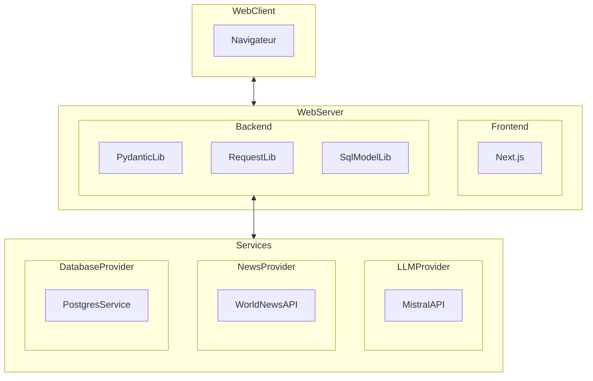
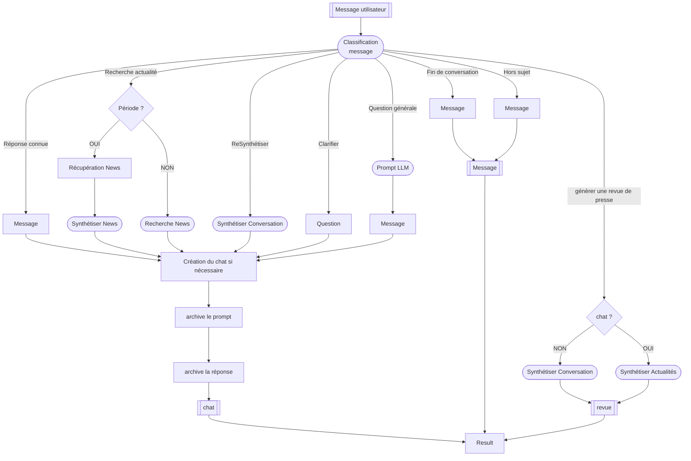

# NewsFoundry - Développement

[](https://github.com/Ace4teaM/OCR-NewsFoundry/actions/workflows/python-tests.yml)

**Synthétise les choix de conceptions et les outils nécessaires au développement du projet.**

Ce document est écrit et modifié par l'équipe de **développement informatique**.
> merci de mettre à jour ce document en cas de modifications du projet.

# Architecture

**NewsFoundry** est réalisé sur une architecture **FullStack Web**.

Ce graphique représente les dépendances entre les différents composants de l'architecture logicielle:




## Prérequis

- Docker
- Python 3.13
- uv
- Node.js 22.19

## Variables d'environnement

**Frontend**

| Variable              | Description                                                  |
| --------------------- | ------------------------------------------------------------ |
| `NEXT_PUBLIC_API_URL` | URL de l'API accessible depuis le navigateur. Le préfixe `NEXT_PUBLIC_` permet d'exposer cette variable au code JavaScript côté client Next.js. |
| `API_URL`             | URL de l'API utilisée côté serveur Next.js. Cette variable reste privée et n'est pas exposée au navigateur. |

**Backend**

| Variable                          | Description                                                  |
| --------------------------------- | ------------------------------------------------------------ |
| `ALLOW_ORIGINS`                   | Liste des origines autorisées à accéder à l'API via CORS. (séparé par des barres verticales `|` ).<br />**Exemple:** `https://ocr-newsfoundry.onrender.com|https://ocr-news-foundry.vercel.app` |
| `DATABASE_URL`                    | URL de connexion à la base de données PostgreSQL.            |
| `JWT_SECRET_KEY`                  | Clé secrète utilisée pour signer et vérifier les jetons JWT d'authentification. |
| `JWT_ACCESS_TOKEN_EXPIRE_MINUTES` | Optionnel. Temps avant expiration du Token de session (30 par défaut) |
| `COOKIE_SECURE`                   | Active ou désactive l'attribut `Secure` des cookies HTTP. Lorsqu'il est activé, les cookies sont transmis uniquement via HTTPS (généralement en production). |
| `MISTRAL_API_KEY`                 | Clé API permettant d'accéder aux modèles d'intelligence artificielle de Mistral. |
| `WORLDNEWS_API_KEY`               | Clé API permettant d'accéder aux services de l'API World News. |

## Production

Le projet est configuré pour être déployé à chaque changement de commit sur GitHub.

**Frontend**

> Le projet est actuellement déployé sur cette URL pour une période limitée. Vous pouvez cependant recréer un déploiement à partir des paramètres ci-dessous.

https://ocr-news-foundry.vercel.app/login

**Paramètres de déploiement Vercel.com**

>  https://vercel.com

Copier les variables d'environnement présentes dans le fichier `.env.production`


**Base de données**

**NewsFoundry** exige une instance `Postgresql` pour déployer les schémas de la base de données

> Il est conseiller de créer l'instance avec le déploiement du **backend** pour éviter un redémarrage nécessaire à la création de la base de données

**Backend**

> Le projet est actuellement déployé sur cette URL pour une période limitée. Vous pouvez cependant recréer un déploiement à partir des paramètres ci-dessous.

https://ocr-newsfoundry-yn70.onrender.com/

**Paramètres de déploiement Render.com**

>  https://render.com/

Lors du déploiement du backend certains paramètres doivent être renseigné


Copier les variables d'environnement présentes dans le fichier `.env.remote`

> ATTENTION à mettre à jour les URL en cas de changement de fournisseur


## Local

En développement local.

**Frontend**
Next.js
http://localhost:3000/

**Base de données**

**NewsFoundry** exige une instance `Postgresql` pour déployer les schémas de la base de données

> Vous pouvez créer une instance Docker avec la commande suivante

```
docker run --name newsfoundry_db -e POSTGRES_USER=user -e POSTGRES_PASSWORD=password -e POSTGRES_DB=newsfoundry -p 5432:5432 postgres:17
```

**Backend**
FastAPI
http://localhost:8000/docs

# Développement

## Logique d'exécution du chat

Fonctionnement du chat et enchaînement des différentes étapes nécessaires au traitement d'un message utilisateur. Décrit le rôle des agents IA, les décisions prises en fonction de la demande, ainsi que l'orchestration des traitements par le backend, depuis la réception du message jusqu'à la génération de la réponse.



## Proxy

[gestion du login...]

* redirection vers /login

## Revues de presses

Chaque utilisateur dispose de son historique de revues de presses générées à partir des différents chat de discutions
L'utilisateur à la possibilité ensuite de visualiser l'ensemble des revues de presses dans une vue dédiée

# Tests unitaires

## Liste des tests

- Un utilisateur valide reçoit un cookie JWT HttpOnly
- Un email incorrect ne permet pas de se connecter
- Un mot de passe incorrect ne permet pas de se connecter


## Executer les tests

```bash
uv run --env-file .env pytest -v
```

# 